# SOKTRAPA — Sales Management Information System

**A Java Swing and MySQL desktop application for managing customers, sales orders, inventory, invoices, payments and product returns. It was built for a Tunisian agri-food company and documented with UML.**


-C71A36?logo=apachemaven&logoColor=white)


<p align="center">
  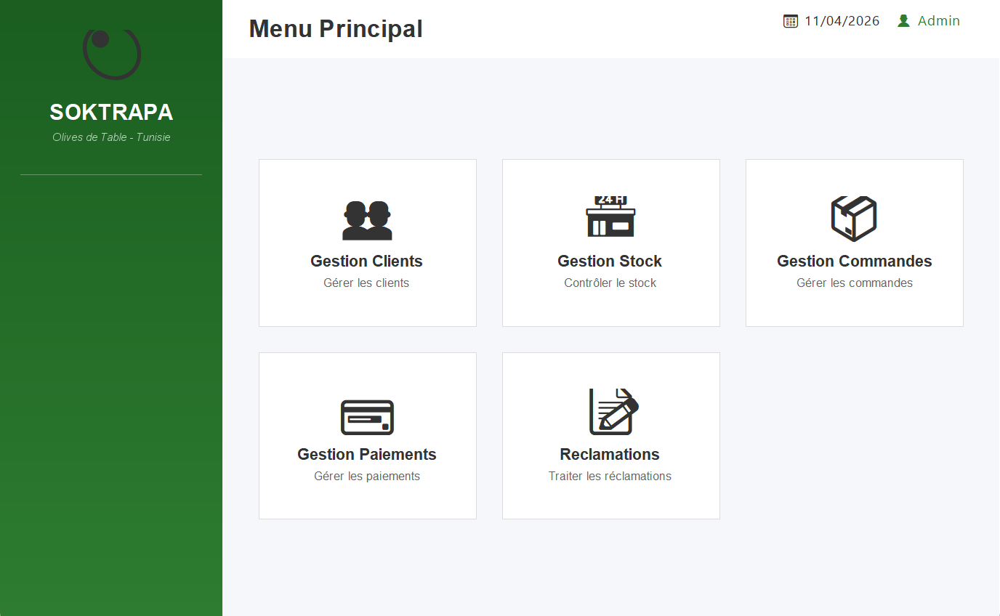
  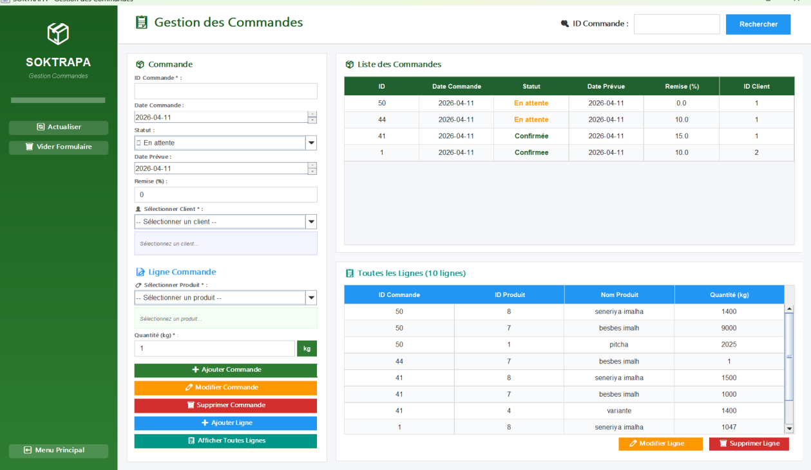
</p>

| | |
|---|---|
| **Type** | Desktop application (not a website, so there is no live demo) |
| **Stack** | Java · Swing · JDBC · MySQL/MariaDB · SQL · UML · Eclipse IDE |
| **Size** | 9 Java classes, about 7,300 lines · 10 relational tables · 8 foreign keys · 24 UML diagrams |
| **Context** | Academic internship project, Bachelor in Business Computing (Business Intelligence), ISGIS, University of Sfax |
| **Author** | Edam Ketata |

---

## Table of contents

1. [Introduction](#1-introduction)
2. [Business context](#2-business-context)
3. [Business problem](#3-business-problem)
4. [Project objectives](#4-project-objectives)
5. [Main functionalities](#5-main-functionalities)
6. [Technology stack](#6-technology-stack)
7. [Application architecture](#7-application-architecture)
8. [UML diagrams](#8-uml-diagrams)
9. [Database schema](#9-database-schema)
10. [Installation requirements](#10-installation-requirements)
11. [MySQL setup](#11-mysql-setup)
12. [Eclipse import](#12-eclipse-import)
13. [JDBC configuration](#13-jdbc-configuration)
14. [Running the application](#14-running-the-application)
15. [Screenshots](#15-screenshots)
16. [Database documentation](#16-database-documentation)
17. [Quality, tests and security](#17-quality-tests-and-security)
18. [Project limitations](#18-project-limitations)
19. [Future improvements](#19-future-improvements)
20. [Author and academic context](#20-author-and-academic-context)

---

## 1. Introduction

SOKTRAPA is a desktop **sales management information system**. It replaces the manual and spreadsheet-based way the company's sales department worked. It covers the full commercial cycle:

```text
Customer ──► Order (+ order lines) ──► Stock check & stock update ──► Invoice (discount + VAT) ──► Payments ──► Returns / complaints
```

The project covers the full software engineering cycle: analysis of the existing processes, requirements specification, UML modelling (use-case, sequence and class diagrams), relational database design, and a Java Swing implementation connected to MySQL through JDBC.

## 2. Business context

**SOKTRAPA** is a Tunisian company in Sfax that conditions and processes agricultural products, mainly **table olives**. Its work includes sorting, grading, brining, storage and packaging. It also resells imported finished products such as capers and pickles. The sales department handles customer orders, finished-goods stock, invoicing and customer payments.

## 3. Business problem

The internship report's study of the existing system found that sales operations ran mostly on **manual procedures and Excel files**. This caused:

* input errors and duplicated data between departments,
* poor **traceability** of orders, invoices, payments and returns,
* no real-time view of **finished-goods stock** when an order is taken,
* slow invoicing and follow-up of customer balances.

## 4. Project objectives

* Centralise customer, order, stock, invoice, payment and return data in a **single relational database**.
* **Check stock automatically** when an order line is entered, and keep the stock up to date.
* **Generate invoices automatically** from confirmed orders (discount and 7% VAT).
* Track **payments and remaining balances** per invoice.
* Record and follow up **product returns** linked to invoices.
* Provide a simple, consistent desktop interface for non-technical users.

## 5. Main functionalities

Every item below was checked in the Java source and exercised by the [integration test](#17-quality-tests-and-security). Items the report describes but the code does not implement are listed in [Limitations](#18-project-limitations).

| Module | Class | Features |
|---|---|---|
| 🔐 **Authentication** | `LoginSoktrapa`, `MenuPrincipal` | Administrator login (parameterised query, PBKDF2 password hash), main menu with five modules |
| 👥 **Customers** | `GestionClients` | Create, view, update, delete, multi-criteria search · customer type (Entreprise / Grossiste / Détaillant) · payment terms (Comptant, 30/60/90 jours, Fin de mois) · credit limit |
| 🛒 **Orders** | `GestionCommandes` | Create, update and delete orders · customer selection · order date and expected delivery date · status (En attente / Confirmée / Annulée) · discount % · **order lines** (add, modify, delete) · **automatic stock control** (blocks the line if stock is insufficient, warns when stock runs low) · stock decreased or restored **in a single transaction** |
| 📦 **Inventory** | `GestionStock` | View depots, lots, locations and quantities · product-to-depot mapping · **inventory** (physical count, surplus or shortage detection, adjustment) · **stock exit** · availability check |
| 💰 **Invoices & payments** | `GestionPaiement` | Invoice generation from confirmed, not-yet-invoiced orders · detailed invoice (lines, gross amount, discount, VAT 7%, **NET TTC**) · record, update, delete and search payments · payment method and status · **remaining balance** |
| ↩️ **Returns & complaints** | `Reclamation` | Return requests linked to an invoice · reason and product condition · update, delete, view, search |

## 6. Technology stack

| Layer | Technology |
|---|---|
| Language | **Java** (source level 17, originally developed on JDK 22) |
| User interface | **Java Swing** (custom-painted panels, `JTable`, `JComboBox`, `JSpinner`, `SwingWorker`) |
| Data access | **JDBC** with `PreparedStatement`, transactions (`commit` / `rollback`), try-with-resources |
| Database | **MySQL / MariaDB** (developed with XAMPP / MariaDB 10.4, tested on MariaDB 10.11), InnoDB, utf8mb4 |
| Driver | MySQL Connector/J 9.6.0 |
| Modelling | **UML**: use-case, sequence and class diagrams · relational model |
| IDE / build | **Eclipse IDE** (original project files kept) · optional **Maven** build |
| Security | PBKDF2-HMAC-SHA256 password hashing (JDK built-in) |

## 7. Application architecture

The application has two tiers: Swing windows talk to MySQL directly through JDBC. Each module is a `JFrame` that holds its view, its event handlers and its SQL. Connection settings and password hashing live in two shared helper classes.

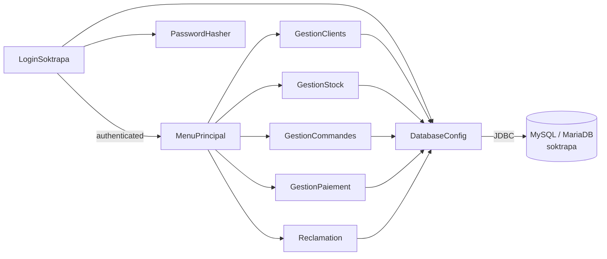

```text
sales-management-information-system/
├── README.md
├── LICENSE
├── pom.xml                      # optional Maven build (runnable JAR + driver)
├── .project / .classpath / .settings/   # Eclipse project (original, made portable)
├── src/main/java/projet/
│   ├── LoginSoktrapa.java       # entry point: login window
│   ├── MenuPrincipal.java       # dashboard
│   ├── GestionClients.java      # customers
│   ├── GestionCommandes.java    # orders, order lines, stock control
│   ├── GestionStock.java        # inventory
│   ├── GestionPaiement.java     # invoices & payments
│   ├── Reclamation.java         # returns & complaints
│   ├── DatabaseConfig.java      # JDBC settings (no credentials in code)
│   └── PasswordHasher.java      # PBKDF2 hashing + CLI
├── database/
│   ├── schema.sql               # 10 tables, keys, foreign keys
│   ├── sample_data.sql          # fictional demo dataset
│   └── README.md
├── config/database.properties.example
├── lib/README.md                # where to put the MySQL JDBC driver
├── tests/
│   ├── integration/SwingIntegrationTest.java
│   └── run-integration-tests.sh
└── docs/
    ├── project-report.pdf       # internship report (customer data redacted)
    ├── architecture.md · requirements.md · database-design.md · security-audit.md
    ├── uml/                     # 24 diagrams extracted from the report
    └── screenshots/             # 7 application screenshots
```

More detail: [`docs/architecture.md`](docs/architecture.md).

## 8. UML diagrams

The report contains **24 UML diagrams**: 6 use-case diagrams, 17 sequence diagrams and 1 class diagram. They are copied unchanged into [`docs/uml/`](docs/uml/README.md).

| Use cases (global) | Class diagram |
|---|---|
| 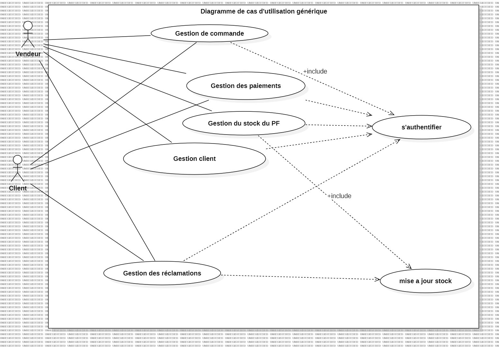 | 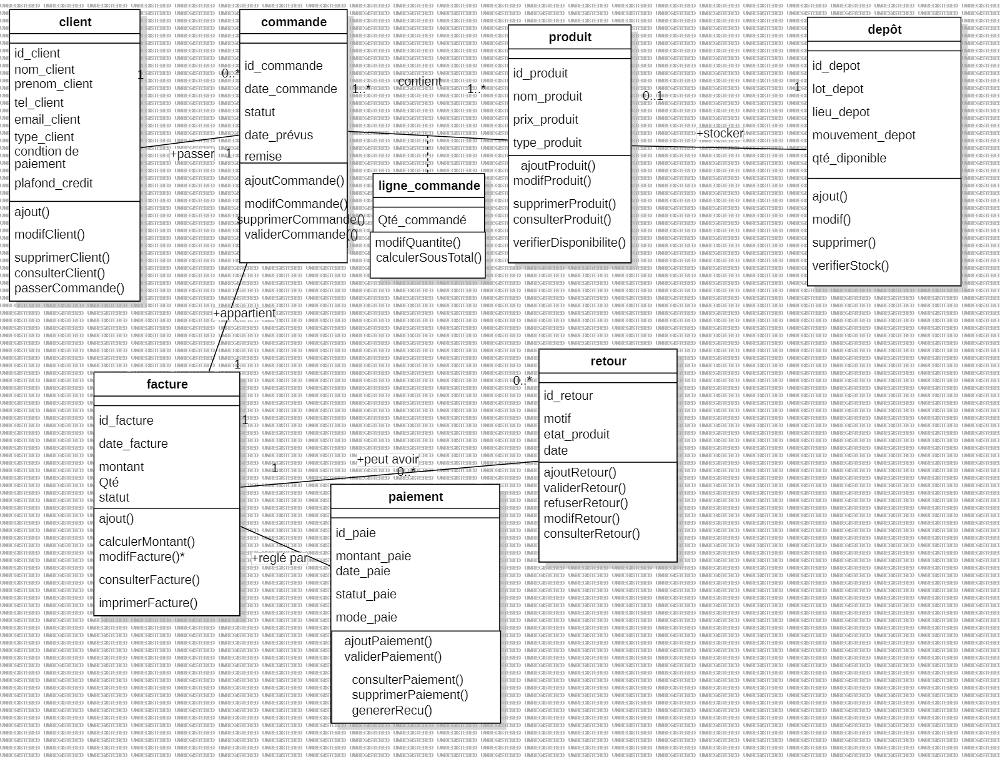 |

| Sequence: create order (stock check) | Sequence: invoice generation |
|---|---|
| 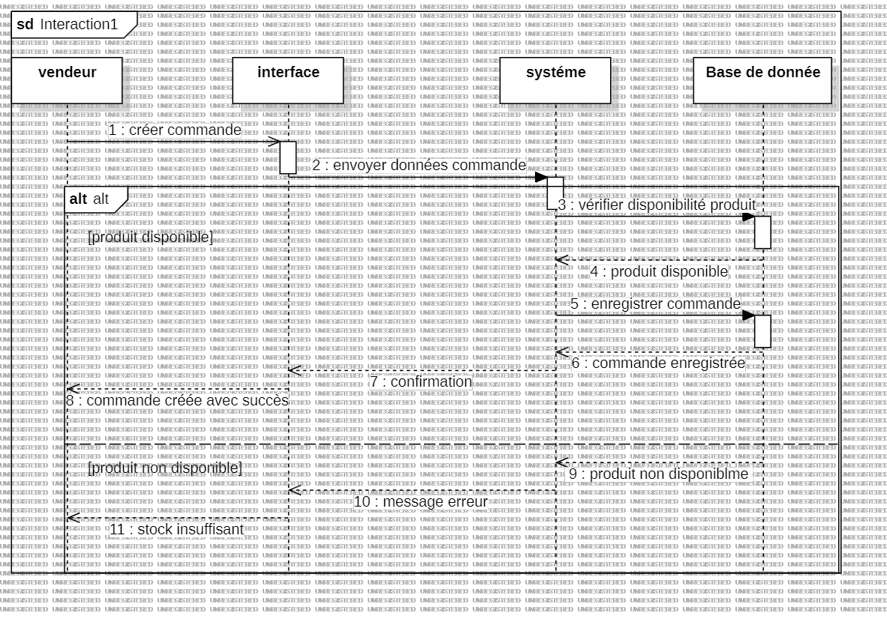 | 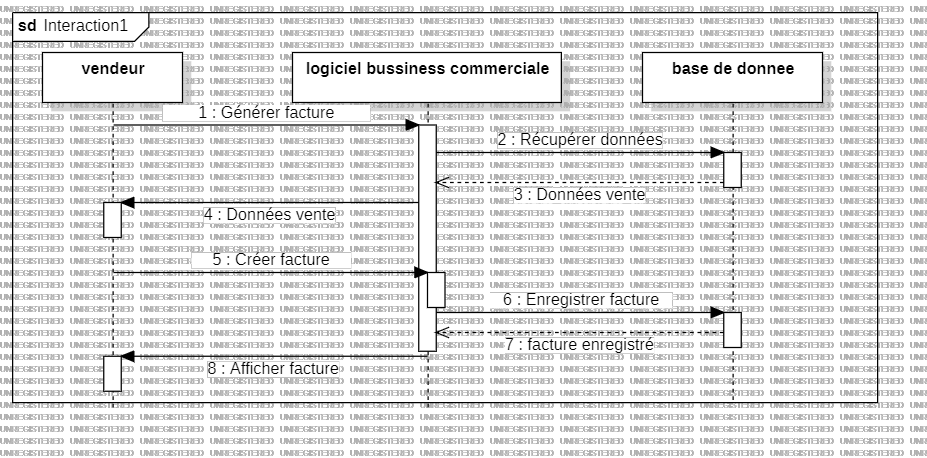 |

Full index, by module: [`docs/uml/README.md`](docs/uml/README.md). It also lists the differences between the diagrams and the implementation.

## 9. Database schema

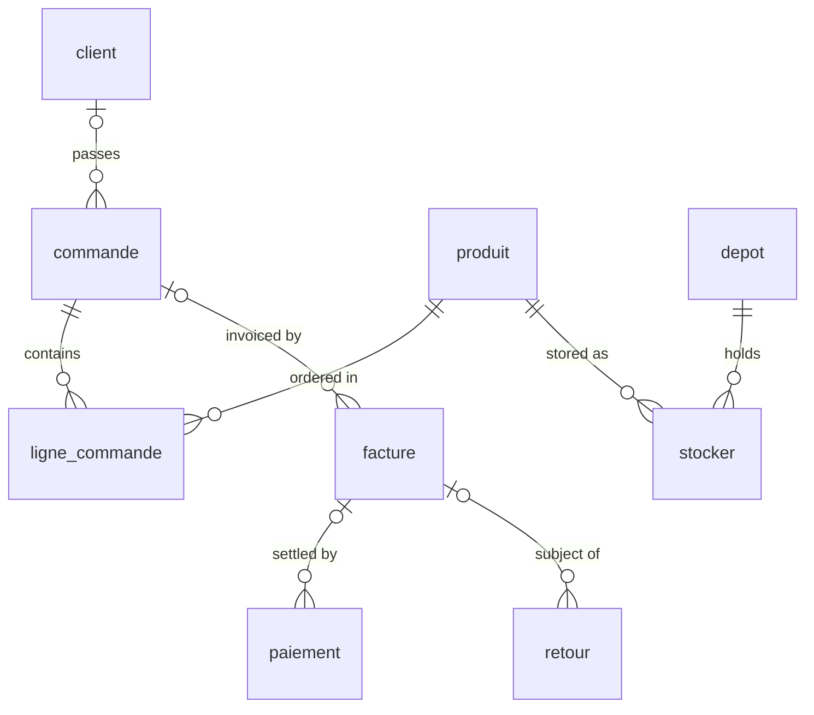

| Table | Purpose | Key columns |
|---|---|---|
| `administration` | Application accounts | `id` PK |
| `client` | Customers, type, payment terms, credit limit | `id_client` PK |
| `commande` | Sales orders (status, discount, dates) | `id_commande` PK, `id_client` FK |
| `ligne_commande` | Order lines (quantity) | (`id_commande`, `id_produit`) PK/FK |
| `produit` | Finished products and prices | `id_produit` PK |
| `depot` | Lots, locations, available quantity | `id_depot` PK |
| `stocker` | Product-to-depot association | (`id_produit`, `id_depot`) PK/FK |
| `facture` | Invoices (NET TTC, quantity, status) | `id_facture` PK, `id_commande` FK |
| `paiement` | Payments (amount, method, status) | `id_paie` PK, `id_facture` FK |
| `retour` | Product returns (reason, condition) | `id_retour` PK, `id_facture` FK |

## 10. Installation requirements

| Requirement | Version |
|---|---|
| JDK | **17 or later** (tested with JDK 21) |
| Database | **MySQL 8.x** or **MariaDB 10.4+** (XAMPP works) |
| JDBC driver | MySQL Connector/J 9.x (see [`lib/README.md`](lib/README.md)), or let Maven download it |
| IDE (optional) | Eclipse IDE for Java Developers (2024 or later) |
| Build (optional) | Maven 3.9+ |

## 11. MySQL setup

```bash
git clone https://github.com/Edambi12/sales-management-information-system.git
```

```bash
cd sales-management-information-system
```

```bash
mysql -u root -p < database/schema.sql
```

```bash
mysql -u root -p soktrapa < database/sample_data.sql
```

Recommended: create a dedicated **least-privilege** account for the application:

```sql
CREATE USER 'soktrapa_app'@'localhost' IDENTIFIED BY 'choose-a-strong-password';
GRANT SELECT, INSERT, UPDATE, DELETE ON soktrapa.* TO 'soktrapa_app'@'localhost';
```

With XAMPP you can import the two scripts through phpMyAdmin instead. See [`database/README.md`](database/README.md).

## 12. Eclipse import

1. Put `mysql-connector-j-9.6.0.jar` in the `lib/` folder ([instructions](lib/README.md)).
2. In Eclipse, choose **File → Import → General → Existing Projects into Workspace** and select the cloned folder. The project is called `projet`, as in the original.
3. Check that the project uses a JDK 17+ (*Project → Properties → Java Build Path → Libraries*).
4. Create `config/database.properties` (next section).

> **Alternative:** use **File → Import → Maven → Existing Maven Projects**. Eclipse m2e then reads `pom.xml` and downloads the driver automatically.

## 13. JDBC configuration

Credentials are **not** in the source code. Copy the template and fill in your values:

```bash
cp config/database.properties.example config/database.properties
```

```properties
db.url=jdbc:mysql://localhost:3306/soktrapa
db.user=YOUR_DB_USER
db.password=YOUR_DB_PASSWORD
```

`config/database.properties` is ignored by Git. You can also use the environment variables `SOKTRAPA_DB_URL`, `SOKTRAPA_DB_USER` and `SOKTRAPA_DB_PASSWORD`, or point to another file with `-Dsoktrapa.config=/path/file.properties`. The application looks for the file relative to its working directory, which is the project root when launched from Eclipse or Maven.

## 14. Running the application

**From Eclipse:** right-click `LoginSoktrapa.java` and choose **Run As → Java Application**.

**From the command line (Maven):**

```bash
mvn package
```

```bash
java -jar target/soktrapa-1.0.0.jar
```

**Demo login** (fictional dataset, local use only):

| User | Password |
|---|---|
| `admin` | `Soktrapa@Demo2026` |

To create a new administrator password hash:

```bash
java -cp target/classes projet.PasswordHasher "NewStrongPassword"
```

## 15. Screenshots

These are real screenshots taken from the internship report. Customer personal data is redacted.

| Login | Main menu |
|---|---|
| 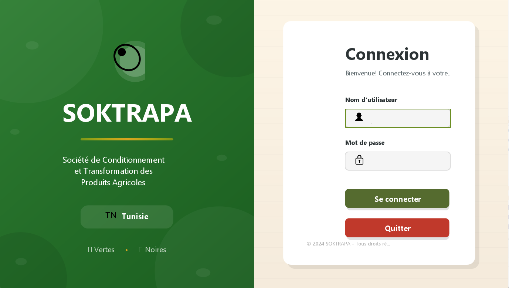 |  |
| **Customer management** | **Stock management** |
| 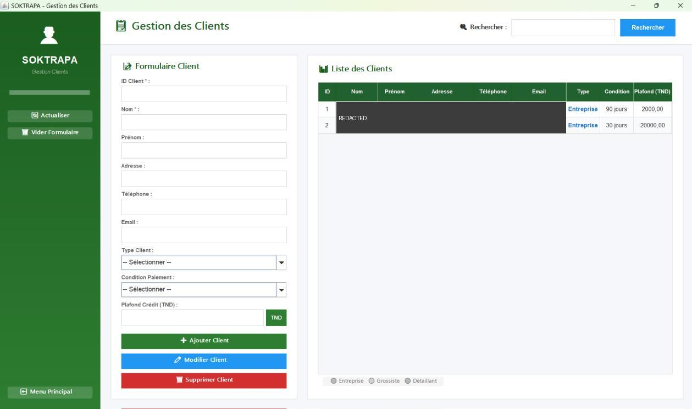 | 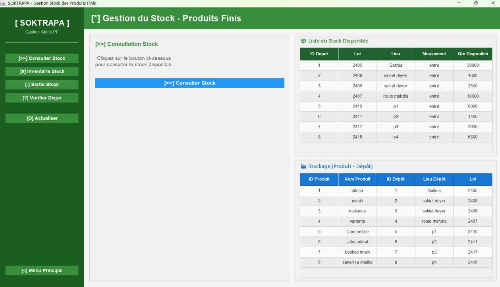 |
| **Order management** | **Invoices & payments** |
|  | 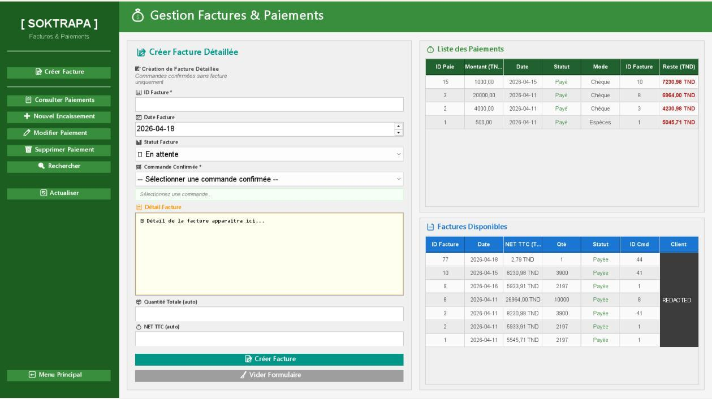 |
| **Returns & complaints** | |
| 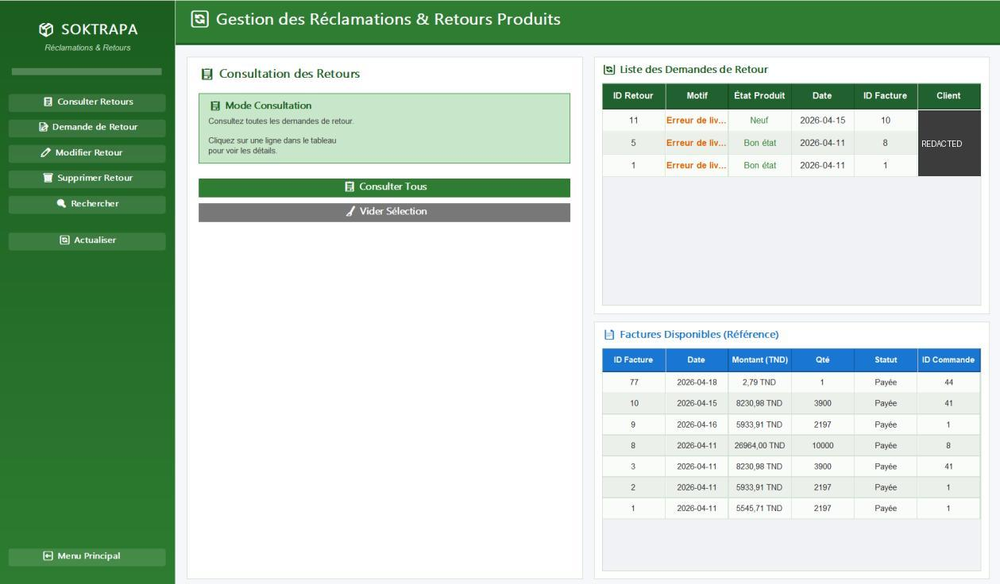 | |

## 16. Database documentation

* [`docs/database-design.md`](docs/database-design.md): every table and column, keys, relationships, cascade behaviour, the business rules implemented in Java, and the differences between the report's data dictionary and the real schema.
* [`database/README.md`](database/README.md): installation, least-privilege account, demo login, and how the sample data was built.
* [`docs/requirements.md`](docs/requirements.md): each requirement from the report with its implementation status.

## 17. Quality, tests and security

| Check | Result |
|---|---|
| Java compilation (`mvn package`, JDK 21, `--release 17`) | ✅ Builds with no errors (`-Xlint:all`) |
| Schema import (`schema.sql` + `sample_data.sql`) on MariaDB 10.11 | ✅ Imports cleanly. Columns, types and keys are identical to the original export |
| Foreign keys and data consistency | ✅ All 8 FKs present. Every invoice equals the recomputed NET TTC |
| Application start-up (`java -jar`, headless X server) | ✅ Login window starts with no exception |
| **Integration test**: real Swing frames + JDBC + MariaDB, least-privilege DB account | ✅ **38 / 38 checks pass**, and the test can be re-run |
| Login workflow (valid, wrong password, unknown user, injection-style input, legacy plain-text row) | ✅ Tested |
| CRUD workflows for all five modules, stock control, invoice computation | ✅ Tested (see the test source) |
| Visual check of the screens on Windows / Eclipse | ⚠️ Not done in this environment. The screenshots come from the author's report |

The integration test is [`tests/integration/SwingIntegrationTest.java`](tests/integration/SwingIntegrationTest.java). It opens each module window, fills in the form fields, calls the real event handlers and checks the result in the database. Run it with:

```bash
./tests/run-integration-tests.sh
```

**Security work before publication** (full report: [`docs/security-audit.md`](docs/security-audit.md)):

* Removed the hardcoded `root` / empty-password database credentials from 6 classes, and added external configuration.
* Replaced plain-text password comparison with **PBKDF2-HMAC-SHA256** hashing and constant-time verification.
* Replaced the real-looking customer records with a **fictional dataset**. The original SQL export is not published.
* **Redacted** customer data in the screenshots and inside the published PDF.
* Reviewed every query for SQL injection: all user input goes through `PreparedStatement`.
* Fixed a type bug in the stock module (`lot_depot` was read as an integer) and the absolute Windows path to the JDBC driver.

## 18. Project limitations

This is an academic project and is not production software:

* **One administrator account**, with no roles. The report's actors (seller, treasurer, storekeeper) are not separated, and each module can also be started from its own `main()`.
* **UI, business logic and SQL live in the same Swing classes**, and there are no unit tests (only the integration test).
* All foreign keys are `ON DELETE CASCADE`, so deleting a customer also deletes their orders, invoices, payments and returns.
* Deleting a whole order does not restore its stock (deleting a single order line does).
* There is no stock movement history and no FIFO/LIFO lot management. Returns do not update stock.
* There is no screen to manage products or depots, and invoices cannot be edited, printed or exported to PDF.
* IDs are typed by hand although the columns are `AUTO_INCREMENT`.
* The VAT rate (7%) and the stock alert thresholds are hardcoded. The interface is in French only.

## 19. Future improvements

* Add a **DAO / service layer** with domain classes that match the class diagram, plus JUnit tests for the business rules.
* Add **role-based access** (seller, treasurer, storekeeper) and account lockout.
* Add a **stock movement journal**, update stock on returns, and manage lots (FIFO).
* Add product and depot screens, invoice editing, and **PDF invoice and receipt** generation.
* Use `ON DELETE RESTRICT` with soft delete, and add `DECIMAL` types for money columns.
* Add reporting and **Business Intelligence** dashboards (sales by customer, product and period), as the report suggests, plus notifications.
* Package the app as a native installer (`jpackage`).

## 20. Author and academic context

**Edam Ketata**, Bachelor's degree in **Business Computing**, specialisation **Business Intelligence**,
**Higher Institute of Industrial Management of Sfax (ISGIS)**, University of Sfax, Tunisia.

Internship project carried out at **SOKTRAPA** (Sfax) and presented in the report *"Conception et réalisation d'une application de vente chez SOKTRAPA"* (academic year 2026/2027). Full report: [`docs/project-report.pdf`](docs/project-report.pdf) (French, customer data redacted).

---

<sub>Code under the MIT License (see [LICENSE](LICENSE)). The SOKTRAPA name belongs to the company. The dataset in this repository is fictional.</sub>
