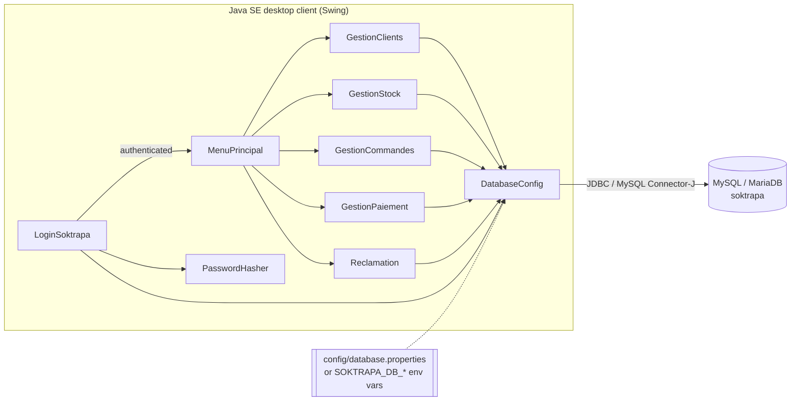

# Application architecture

## 1. Style

SOKTRAPA is a **two-tier desktop application**: a Java Swing client talks directly to
a MySQL/MariaDB server through JDBC. There is no application server and no web layer.

Each business module is a self-contained `JFrame` that combines three
responsibilities — **view** (Swing components), **controller** (event handlers) and
**data access** (SQL through JDBC). This "smart form" structure is typical of academic
and small internal business tools; it is simple to follow but couples UI and data
access (see *Possible evolution* below).

## 2. Classes

| Class | Lines | Responsibility | Main tables |
|---|---:|---|---|
| `LoginSoktrapa` | ~640 | Login window; verifies credentials in a `SwingWorker` (off the UI thread). Application entry point. | `administration` |
| `MenuPrincipal` | ~240 | Dashboard with one tile per module. | — |
| `GestionClients` | ~850 | Customer CRUD + search. | `client` |
| `GestionCommandes` | ~1400 | Orders and order lines, stock control, transactional stock updates. | `commande`, `ligne_commande`, `client`, `produit`, `stocker`, `depot` |
| `GestionStock` | ~1140 | Stock consultation, inventory, stock exit, availability check. | `depot`, `stocker`, `produit` |
| `GestionPaiement` | ~1520 | Invoice generation (discount + VAT), payment CRUD and search, balances. | `facture`, `paiement`, `commande`, `ligne_commande`, `produit`, `client` |
| `Reclamation` | ~1340 | Product return requests CRUD + search. | `retour`, `facture`, `commande`, `client` |
| `DatabaseConfig` | new | Loads JDBC URL/user/password from config file or environment; opens connections. | — |
| `PasswordHasher` | new | PBKDF2-HMAC-SHA256 hashing/verification + CLI to generate hashes. | — |

Navigation: every module has a *Menu Principal* button that disposes the module and
opens a new `MenuPrincipal`. Every class also has its own `main()` (handy for
development, but it bypasses the login screen — see the security audit).

## 3. Data access patterns

* `DatabaseConfig.getConnection()` opens a new connection per operation
  (no pool — acceptable for a single-user desktop tool).
* `try-with-resources` is used for connections and most statements.
* **All user input goes through `PreparedStatement`**; plain `Statement` is used only
  for constant `SELECT` queries without parameters.
* Multi-step operations in the order module (insert line + update stock, delete order +
  lines) run in an explicit transaction with commit/rollback.
* SQL errors are translated into user-friendly dialogs (duplicate key, foreign key).

## 4. Key workflows

### Adding an order line (stock control)
1. Validate product and quantity (> 0).
2. `setAutoCommit(false)`.
3. `controlerStock`: read the depot with the highest quantity for the product
   → **block** if quantity > available, **warn** if remaining ≤ 1000 kg or < 50 %.
4. `INSERT INTO ligne_commande`.
5. `diminuerStock`: `UPDATE depot JOIN stocker … SET qte_disponible = qte_disponible - ?`.
6. `commit` (or `rollback` on any error).

### Generating an invoice
1. List confirmed orders that have no invoice.
2. Compute gross amount from `ligne_commande × produit.prix_produit`,
   apply the order discount, add 7 % VAT → NET TTC.
3. Show a detailed text invoice, then `INSERT INTO facture`.

## 5. Build & tooling

| Tool | Role |
|---|---|
| Eclipse IDE (`.project`, `.classpath`, `.settings/`) | Original development environment; project imports as a plain Java project. |
| Maven (`pom.xml`, optional) | Command-line build, fetches MySQL Connector/J, produces a runnable JAR. |
| `tests/run-integration-tests.sh` | Builds and runs the Swing/JDBC integration test (Xvfb on headless Linux). |

## 6. Possible evolution (not implemented)

* Extract a **DAO / repository layer** (`ClientDao`, `CommandeDao`, …) and domain classes
  (`Client`, `Commande`, …) matching the class diagram, so SQL leaves the Swing classes.
* Introduce a **service layer** for business rules (stock control, invoice computation)
  and unit-test it with JUnit.
* Share UI styling helpers (colours, buttons, table renderers are duplicated across frames).
* Connection pooling (HikariCP) if the tool becomes multi-user.
