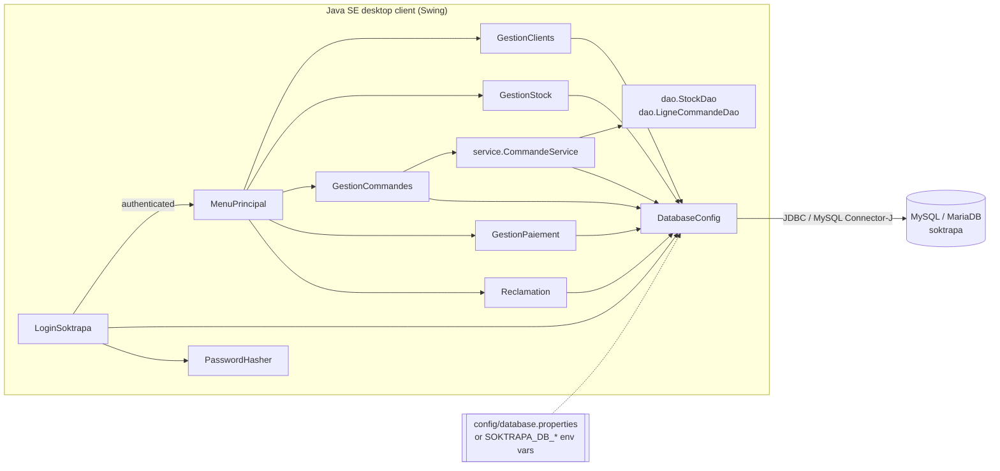

# Application architecture

## 1. Style

SOKTRAPA is a **two-tier desktop application**: a Java Swing client talks directly to
a MySQL/MariaDB server through JDBC. There is no application server and no web layer.

Most business modules are a self-contained `JFrame` that combines three
responsibilities — **view** (Swing components), **controller** (event handlers) and
**data access** (SQL through JDBC). This "smart form" structure is typical of academic
and small internal business tools; it is simple to follow but couples UI and data access.

The order-line / stock rules are the exception: they were extracted into a
**Model → DAO → Service** layer, as the first step of a gradual migration
(see *Layered slice* and *Migration path* below).



## 2. Classes

| Class | Lines | Responsibility | Main tables |
|---|---:|---|---|
| `LoginSoktrapa` | ~640 | Login window; verifies credentials in a `SwingWorker` (off the UI thread). Application entry point. | `administration` |
| `MenuPrincipal` | ~240 | Dashboard with one tile per module. | — |
| `GestionClients` | ~850 | Customer CRUD + search. | `client` |
| `GestionCommandes` | ~1290 | Orders and order lines (form validation, display); delegates line/stock operations to `CommandeService`. | `commande`, `client`, `produit` (+ `ligne_commande` for display) |
| `GestionStock` | ~1140 | Stock consultation, inventory, stock exit, availability check. | `depot`, `stocker`, `produit` |
| `GestionPaiement` | ~1520 | Invoice generation (discount + VAT), payment CRUD and search, balances. | `facture`, `paiement`, `commande`, `ligne_commande`, `produit`, `client` |
| `Reclamation` | ~1340 | Product return requests CRUD + search. | `retour`, `facture`, `commande`, `client` |
| `DatabaseConfig` | new | Loads JDBC URL/user/password from config file or environment; opens connections. | — |
| `PasswordHasher` | new | PBKDF2-HMAC-SHA256 hashing/verification + CLI to generate hashes. | — |
| `service.CommandeService` | new | Order-line and stock business rules; owns the transactions. No Swing. | — |
| `dao.StockDao`, `dao.LigneCommandeDao` | new | SQL for depot quantities and order lines; row locks; never commit. | `depot`, `stocker`, `ligne_commande` |
| `model.ControleStock`, `model.SuppressionCommande` | new | Immutable results returned to the UI. | — |

Navigation: every module has a *Menu Principal* button that disposes the module and
opens a new `MenuPrincipal`. Every class also has its own `main()` (handy for
development, but it bypasses the login screen — see the security audit).

## 3. Data access patterns

* `DatabaseConfig.getConnection()` opens a new connection per operation
  (no pool — acceptable for a single-user desktop tool).
* `try-with-resources` is used for connections and most statements.
* **All user input goes through `PreparedStatement`**; plain `Statement` is used only
  for constant `SELECT` queries without parameters.
* Multi-step operations on order lines and stock run in one transaction inside
  `CommandeService`; rows are read with `SELECT … FOR UPDATE`, and any refusal or error
  rolls everything back. Stock exit and inventory in `GestionStock` are transactional too.
* SQL errors are translated into user-friendly dialogs (duplicate key, foreign key).

## 4. Key workflows

### Adding an order line (stock control)
1. `GestionCommandes` validates product and quantity (> 0) and calls `CommandeService.ajouterLigne`.
2. The service opens a transaction and locks the depot holding the most stock for the product.
3. Decision: **refuse** if quantity > available, **alert** if remaining ≤ 1000 kg or < 50 %.
4. If accepted: decrease that depot (guarded update, exactly one row) and insert the line.
5. `commit`, or `rollback` on refusal or error.
6. The window displays the returned `ControleStock` (alert / refusal / success) after the transaction has ended.

### Deleting an order
1. `CommandeService.supprimerCommande` locks the order's lines.
2. Each line's quantity is returned to stock, the lines are deleted, then the order.
3. If the order has an invoice, the database refuses (`ON DELETE RESTRICT`); everything is
   rolled back and the window explains why.

### Generating an invoice
1. List confirmed orders that have no invoice.
2. Compute gross amount from `ligne_commande × produit.prix_produit`,
   apply the order discount, add 7 % VAT → NET TTC.
3. Show a detailed text invoice, then `INSERT INTO facture`.

## 5. Build & tooling

| Tool | Role |
|---|---|
| Eclipse IDE (`.project`, `.classpath`, `.settings/`) | Original development environment; project imports as a plain Java project. |
| Maven (`pom.xml`, optional) | Command-line build, fetches MySQL Connector/J, produces a runnable JAR. |
| `tests/run-integration-tests.sh` | Builds and runs the Swing/JDBC integration test (Xvfb on headless Linux). |

## 6. Layered slice (implemented)

```text
projet/
├── GestionCommandes.java          UI: validates the form, calls the service, shows the result
├── service/CommandeService.java   rules + transaction boundaries (no Swing)
├── dao/StockDao.java              SQL on depot / stocker (row locks, never commits)
├── dao/LigneCommandeDao.java      SQL on ligne_commande
└── model/ControleStock.java       immutable results (no Swing, no JDBC)
    model/SuppressionCommande.java
```

Rules of the layering: the UI never writes SQL for these operations; DAOs receive the
connection and never commit; the service never opens a dialog.

## 7. Migration path (recommended, not implemented)

The remaining modules can be moved one at a time, each step keeping the application
working and re-running the integration test:

1. Order header: `CommandeDao` + model `Commande`.
2. Invoices and payments: `FactureService` (pure amount computation) + `FactureDao`, `PaiementDao`.
3. Customers: `ClientDao` + model `Client`.
4. Stock screen: reuse `StockDao`.
5. Returns: `RetourDao`.
6. Shared `Transaction` helper, shared UI styling helpers, JUnit tests for services,
   connection pooling if the tool becomes multi-user.

Details and rationale: [`improvement-audit.md`](improvement-audit.md).
