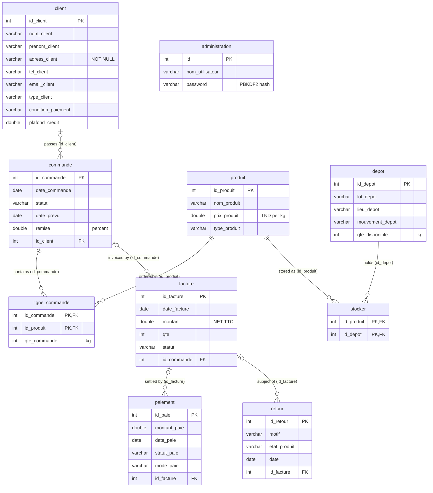

# Database design

Source of truth: [`database/schema.sql`](../database/schema.sql). Tables, columns, types,
primary keys and indexes are those of the original MySQL/MariaDB export of the `soktrapa`
database; only the `ON DELETE` rules of six foreign keys were changed (see *Delete safety*).

## 1. Overview

* **Engine / charset:** InnoDB, `utf8mb4` / `utf8mb4_general_ci`.
* **10 tables:** 8 business entities + 2 association tables.
* **8 foreign keys**: 6 are `ON DELETE RESTRICT`, 2 (association table `stocker`) are `ON DELETE CASCADE`; all are `ON UPDATE CASCADE`.
* Surrogate integer primary keys (`AUTO_INCREMENT`); the two association tables use
  composite primary keys.

| Domain | Tables |
|--------|--------|
| Security | `administration` |
| Customers & sales | `client`, `commande`, `ligne_commande` |
| Catalogue & inventory | `produit`, `depot`, `stocker` |
| Billing & after-sales | `facture`, `paiement`, `retour` |

## 2. Entity–relationship diagram

Generated from the foreign keys of `schema.sql`. A foreign-key column that is
`NULL`-able gives an *optional* parent (`|o`); the child side is always "zero or many"
because no `UNIQUE` constraint restricts it.

The relational model as drawn in the internship report is also available as the
class diagram image [`uml/24-class-diagram.png`](uml/24-class-diagram.png).

## 3. Tables

### `administration` — application accounts
| Column | Type | Null | Key | Notes |
|---|---|---|---|---|
| `id` | int(11) | no | PK, AI | |
| `nom_utilisateur` | varchar(200) | no | | login name (no UNIQUE constraint) |
| `password` | varchar(200) | no | | PBKDF2 hash in the published dataset (see *Security*) |

### `client` — customers
| Column | Type | Null | Key | Notes |
|---|---|---|---|---|
| `id_client` | int(11) | no | PK, AI | entered manually in the UI |
| `nom_client` | varchar(255) | yes | | required by the UI |
| `prenom_client` | varchar(255) | yes | | |
| `adress_client` | varchar(200) | **no** | | |
| `tel_client` | varchar(50) | yes | | |
| `email_client` | varchar(255) | yes | | |
| `type_client` | varchar(50) | yes | | UI values: Entreprise, Grossiste, Détaillant |
| `condition_paiement` | varchar(100) | yes | | UI values: Comptant, 30/60/90 jours, Fin de mois |
| `plafond_credit` | double | yes | | credit limit in TND |

### `commande` — sales orders
| Column | Type | Null | Key | Notes |
|---|---|---|---|---|
| `id_commande` | int(11) | no | PK, AI | |
| `date_commande` | date | yes | | |
| `statut` | varchar(50) | yes | | UI values: En attente, Confirmée, Annulée |
| `date_prevu` | date | yes | | expected delivery date |
| `remise` | double | yes | | discount in % |
| `id_client` | int(11) | yes | FK → `client` | index `id_client` |

### `ligne_commande` — order lines
| Column | Type | Null | Key | Notes |
|---|---|---|---|---|
| `id_commande` | int(11) | no | PK, FK → `commande` | |
| `id_produit` | int(11) | no | PK, FK → `produit` | index `id_produit` |
| `qte_commande` | int(11) | yes | | quantity in kg |

### `produit` — finished products
| Column | Type | Null | Key | Notes |
|---|---|---|---|---|
| `id_produit` | int(11) | no | PK, AI | |
| `nom_produit` | varchar(255) | yes | | |
| `prix_produit` | double | yes | | unit price (TND/kg) |
| `type_produit` | varchar(100) | yes | | olive, mélange, cornichon, … |

### `depot` — storage locations / lots
| Column | Type | Null | Key | Notes |
|---|---|---|---|---|
| `id_depot` | int(11) | no | PK, AI | |
| `lot_depot` | varchar(100) | yes | | lot number |
| `lieu_depot` | varchar(255) | yes | | location |
| `mouvement_depot` | varchar(100) | yes | | label (e.g. `entré`); rows labelled `Transfert` are hidden by the stock screen |
| `qte_disponible` | int(11) | yes | | available quantity (kg) |

### `stocker` — product ↔ depot
| Column | Type | Null | Key |
|---|---|---|---|
| `id_produit` | int(11) | no | PK, FK → `produit` |
| `id_depot` | int(11) | no | PK, FK → `depot` (index `id_depot`) |

### `facture` — invoices
| Column | Type | Null | Key | Notes |
|---|---|---|---|---|
| `id_facture` | int(11) | no | PK, AI | |
| `date_facture` | date | yes | | |
| `montant` | double | yes | | NET TTC computed by the application |
| `qte` | int(11) | yes | | total quantity of the order |
| `statut` | varchar(50) | yes | | En attente, Payée, Annulée |
| `id_commande` | int(11) | yes | FK → `commande` | not UNIQUE: the schema allows several invoices per order |

### `paiement` — payments
| Column | Type | Null | Key | Notes |
|---|---|---|---|---|
| `id_paie` | int(11) | no | PK, AI | |
| `montant_paie` | double | yes | | |
| `date_paie` | date | yes | | |
| `statut_paie` | varchar(50) | yes | | En attente, Payé, Partiel, Annulé, Remboursé |
| `mode_paie` | varchar(50) | yes | | Espèces, Chèque, Virement, Carte bancaire, Effet, Autre |
| `id_facture` | int(11) | yes | FK → `facture` | |

### `retour` — product returns / complaints
| Column | Type | Null | Key | Notes |
|---|---|---|---|---|
| `id_retour` | int(11) | no | PK, AI | |
| `motif` | varchar(255) | yes | | Produit défectueux, Erreur de livraison, Non conforme à la commande |
| `etat_produit` | varchar(100) | yes | | Neuf, Bon état, Endommagé, Très endommagé, Inutilisable |
| `date` | date | yes | | |
| `id_facture` | int(11) | yes | FK → `facture` | |

## 4. Relationships explained

| Relationship | Implemented by | Meaning |
|---|---|---|
| Customer → Orders | `commande.id_client` | A customer places zero or more orders; an order references at most one customer. |
| Order ↔ Product | `ligne_commande` (composite PK) | Many-to-many with quantity; one line per product per order. |
| Product ↔ Depot | `stocker` (composite PK) | Many-to-many; in the demo data each product is stored in exactly one depot. |
| Order → Invoices | `facture.id_commande` | The UI only proposes *confirmed orders without an invoice*, but the schema itself allows several. |
| Invoice → Payments | `paiement.id_facture` | Partial / instalment payments; the UI shows the remaining balance per payment row. |
| Invoice → Returns | `retour.id_facture` | Each return is attached to an invoice (i.e. to a sale). |

### Delete safety

In the original export every foreign key was `ON DELETE CASCADE`: deleting a customer
silently deleted their orders, order lines, invoices, payments and returns. The rules are now:

| Foreign key | `ON DELETE` | Effect |
|---|---|---|
| `commande.id_client` → `client` | RESTRICT | a customer with orders cannot be deleted |
| `ligne_commande.id_commande` → `commande` | RESTRICT | lines are removed by the application, which restores stock first |
| `ligne_commande.id_produit` → `produit` | RESTRICT | a product used in orders cannot be deleted |
| `facture.id_commande` → `commande` | RESTRICT | an invoiced order cannot be deleted |
| `paiement.id_facture` → `facture` | RESTRICT | an invoice with payments cannot be deleted |
| `retour.id_facture` → `facture` | RESTRICT | an invoice with returns cannot be deleted |
| `stocker.id_produit` → `produit`, `stocker.id_depot` → `depot` | CASCADE | association rows follow their parents |

Databases created before this change are upgraded with
[`database/migrations/001_restrict_deletes.sql`](../database/migrations/001_restrict_deletes.sql).
Risk analysis and remaining recommendations (soft delete for customers, invoice
cancellation instead of deletion): [`improvement-audit.md`](improvement-audit.md).

## 5. Business rules implemented in Java (not in SQL)

| Rule | Where |
|---|---|
| Stock check before adding or changing an order line (blocking if insufficient, warning if remaining ≤ 1000 kg or < 50 %) | `service.CommandeService` (`reserver`, `evaluer`) |
| Stock decreased when a line is added, adjusted when it is modified, restored when the line **or the whole order** is deleted — always in the same transaction as the line change, with row locks | `service.CommandeService`, `dao.StockDao`, `dao.LigneCommandeDao` |
| With several depots per product: taken from the depot with the most stock, returned to the product's first depot (one row updated each time) | `dao.StockDao` |
| Invoice amount: `Σ(price × qty) × (1 − discount%)`, then **+ 7 % VAT** | `GestionPaiement.calculerFactureDetaillee` |
| Only confirmed orders without an invoice can be invoiced | `GestionPaiement.chargerCommandesCombo` |
| Remaining balance = invoice NET TTC − payment amount | `GestionPaiement.consulterPaiements` |
| Inventory: physical count replaces the recorded quantity, the gap (surplus/shortage) is reported | `GestionStock.inventaireStock` |
| Stock exit refused when quantity exceeds availability (read and update in one transaction) | `GestionStock.sortieStock` |

## 6. Differences between the report and the actual database

| Topic | Report (section "Modèle relationnel" / data dictionary) | Actual schema (`soktrapa.sql`) |
|---|---|---|
| `administration` table | not listed | present (login) |
| `client.adress_client` | missing from the relational model | present, `NOT NULL` |
| Numeric types | `DECIMAL` (prices, amounts, discount, credit limit) | `double` |
| `tel_client` | `INT(8)` | `varchar(50)` |
| `prenom_client` | `CHAR(50)` | `varchar(255)` |
| `qte_commande` | listed with type `Date` (typo) | `int(11)` |
| `facture.qte` / `facture.statut` | `VARCHAR` / `INT` (swapped) | `int(11)` / `varchar(50)` |
| "Obligatoire = Oui" for most columns | NOT NULL expected | most columns are `NULL`-able; validation is done in the UI |
| `type_client` values | fidèle / normal | UI: Entreprise / Grossiste / Détaillant |
| Order ↔ invoice multiplicity (class diagram) | 1 — 1 | schema allows 1 — 0..* |

| Delete rules | not specified | original export: all `CASCADE`; this repository: `RESTRICT` (see *Delete safety*) |

The type and column differences are documented, not "fixed": the schema published here is
the one the Java code actually runs against.
