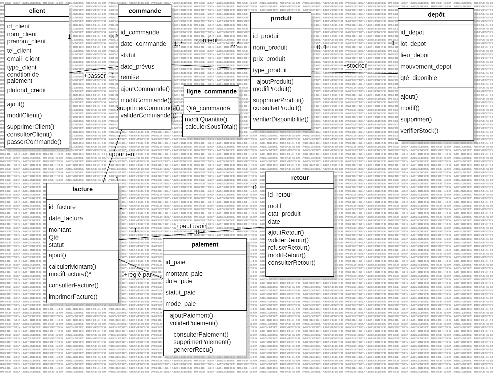

# UML diagrams

All diagrams below were **extracted unchanged** from the internship report
([`../project-report.pdf`](../project-report.pdf), chapters 2 and 3). None were redrawn or
invented. Figure numbers refer to the report. Labels are in French, as in the original.

> The diagrams were produced with an unregistered modelling tool, hence the light
> "UNREGISTERED" watermark in the background of several images.

## Use-case diagrams (chapter 2)

| Fig. | Diagram | File |
|---|---|---|
| 1 | Global use-case diagram (actors: seller, customer) | [01-use-case-global.png](01-use-case-global.png) |
| 2 | Customer management | [02-use-case-customer-management.png](02-use-case-customer-management.png) |
| 3 | Order management | [03-use-case-order-management.png](03-use-case-order-management.png) |
| 4 | Stock management | [04-use-case-stock-management.png](04-use-case-stock-management.png) |
| 5 | Payment management | [05-use-case-payment-management.png](05-use-case-payment-management.png) |
| 6 | Complaints / returns management | [06-use-case-complaints-management.png](06-use-case-complaints-management.png) |

## Sequence diagrams (chapter 3 — dynamic model)

| Fig. | Module | Scenario | File |
|---|---|---|---|
| 7 | Customers | Add customer | [07-sequence-add-customer.png](07-sequence-add-customer.png) |
| 8 | Customers | Update customer | [08-sequence-update-customer.png](08-sequence-update-customer.png) |
| 9 | Customers | Delete customer | [09-sequence-delete-customer.png](09-sequence-delete-customer.png) |
| 10 | Customers | View customers | [10-sequence-view-customers.png](10-sequence-view-customers.png) |
| 11 | Orders | View order | [11-sequence-view-order.png](11-sequence-view-order.png) |
| 12 | Orders | Create order | [12-sequence-create-order.png](12-sequence-create-order.png) |
| 13 | Orders | Cancel order | [13-sequence-cancel-order.png](13-sequence-cancel-order.png) |
| 14 | Stock | View finished-goods stock | [14-sequence-view-stock.png](14-sequence-view-stock.png) |
| 15 | Stock | Inventory | [15-sequence-stock-inventory.png](15-sequence-stock-inventory.png) |
| 16 | Stock | Stock exit | [16-sequence-stock-exit.png](16-sequence-stock-exit.png) |
| 17 | Stock | Check product availability | [17-sequence-check-product-availability.png](17-sequence-check-product-availability.png) |
| 18 | Sales | View sale | [18-sequence-view-sale.png](18-sequence-view-sale.png) |
| 19 | Sales | Create sale | [19-sequence-create-sale.png](19-sequence-create-sale.png) |
| 20 | Payments | Payment collection (*encaissement*) | [20-sequence-payment-collection.png](20-sequence-payment-collection.png) |
| 21 | Payments | View payment | [21-sequence-view-payment.png](21-sequence-view-payment.png) |
| 22 | Payments | Invoice generation | [22-sequence-invoice-generation.png](22-sequence-invoice-generation.png) |
| 23 | Returns | Product return request | [23-sequence-product-return-request.png](23-sequence-product-return-request.png) |

## Class diagram (chapter 3 — static model)

| Fig. | Diagram | File |
|---|---|---|
| 24 | Class diagram "Vente" (client, commande, ligne_commande, produit, dépôt, facture, paiement, retour) | [24-class-diagram.png](24-class-diagram.png) |

## Design vs. implementation

The diagrams describe the *target* design. The Java implementation follows the same
entities and relationships, with these differences (details in
[`../requirements.md`](../requirements.md) and [`../database-design.md`](../database-design.md)):

* The classes of the diagram are realised as **database tables + Swing modules**, not as
  separate Java domain classes.
* Operations such as `validerCommande()`, `imprimerFacture()`, `genererRecu()`,
  `validerRetour()/refuserRetour()`, `ajoutProduit()` and depot CRUD are not implemented
  (order validation is done through the status field).
* The `administration` table (login) does not appear in the diagrams.
* The diagram shows invoice ↔ order as 1–1; the schema allows several invoices per order
  (the UI prevents it by listing only orders without an invoice).
* The `<<include>> mise à jour stock` of the use-case diagram is implemented for order
  lines, but not for returns.
